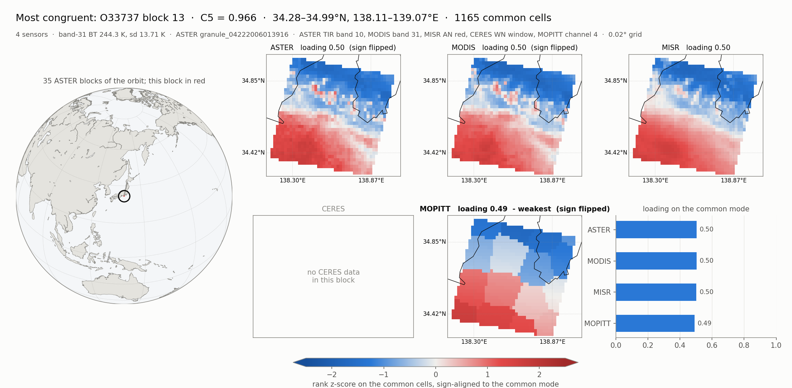
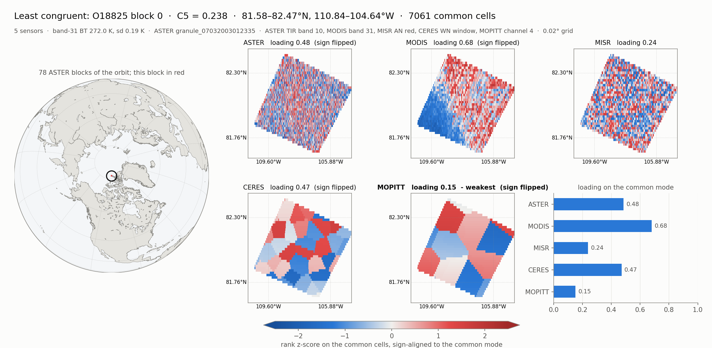

# Terra Fusion congruence test on Aurora: S3 → CAE → CTE tiers → GPU regrid

Run on **Aurora**, 2026-10-09, job 8917505, one node. Repeats the ares
collection-wide congruence study
([~/ares/doc parts 4 and 17](../../ares/doc/20260930_claude_terra_fusion_discrepancy_17_all_granules.md))
with the granules fetched from `s3://terrafusiondatasampler` by CAE instead of
read from local copies.

## Headline

* **The result reproduces ares exactly.** 315 blocks from 7 granules; for every
  block C5, Kendall's W, cell count, weakest sensor and band-31 contrast agree
  with `~/ares/data` (max |ΔC5| = 5.8e-7, on O10670; 0 everywhere else). Same
  answer: **O11602 block 46, C5 = 0.355**. Same three granules excluded, for
  the same reasons.
* **48 min end to end** for 304 GB, ingest included. The ingest is 47 min of
  it (108 MB/s over 10 objects). Each granule's analysis starts as soon as it
  lands and runs alongside the next download, so it adds about 3 s to the end.
* **S3 striping: 3.4× faster ingest.** On a compute node, through the ALCF
  proxy, one stream reached 33 MB/s. Sixteen concurrent 32 MiB ranged GETs
  reached 111 MB/s, which is about where the proxy path plateaus. Without
  striping this run would take 2.6 h instead of 47 min.
* **The GPU regrid matches pytaf bit for bit.** On O10204 (check mode),
  299,948 regridded cells were identical and 0 differed. Each granule ran on
  its own PVC tile (PVC = Ponte Vecchio, the Intel Data Center GPU Max 1550;
  an Aurora node has 6 of them, each split into 2 tiles that run as separate
  devices, so 12 tiles of 64 GB HBM per node), and the regrid took 1.9–16.6 s per granule. A later
  clean-pass run measured it **4.2–6.7× faster than pytaf** on Aurora's CPU
  (1.6–1.9× per granule), against 15.6–21.7× for an A100 on Polaris.
* **Tier choice was set by measurement.** All data went to DRAM. Ingest into
  DRAM measured 104–111 MB/s against 67–80 MB/s into GPU HBM, and the CPU-side
  reader gets nothing from data held in device memory. So HBM is the overflow
  tier and Lustre the last resort; neither held any data in this run.

## The data path

```
s3://terrafusiondatasampler ──CAE (16 ranged GETs)──▶ cfs::/terra_fusion/<granule>.h5
        CTE tiers: DRAM 320 GB (score 1.0) │ GPU HBM 48 GB (0.6) │ Lustre 400 GB (0.2)
                         clio_cte_fuse mount ──▶ unchanged netCDF4 pipeline (ares bin/)
                                                    └─ nearest-neighbour regrid on a PVC tile
```

Each granule goes through the same four stages ares ran: `tf_aster_blocks` →
`tf_sources` → `tf_congruence` → contrast. The configuration is the matched one
from ares parts 11–12: MODIS band 31 and CERES WN_Radiance. The scripts are in
[`src/tf/`](../src/tf), copied from `~/ares/bin` with these changes:

| file | change |
| --- | --- |
| `tf_congruence.py` | `TF_REGRID=gpu\|cpu\|check`: nearest-neighbour search in PyTorch XPU, float64, same great-circle distance and radius as pytaf |
| `tf_contrast.py` | **new**: band-31 BT mean/sd per block (the 2 K floor). ares carries the values but not the script; this one reproduces them exactly |
| `tf_rank_all.py` | attaches the contrast and writes the floor-filtered ranking |
| `tf_compare_ares.py` | **new**: block-by-block comparison with `~/ares/data` |
| `tf_granule.sh` | one granule, four stages, timed |

## Software changes (clio-core, branch `aurora-tf-congruence` in ~/clio-core.dev.wrk)

On top of PR #1258 (anonymous S3 and proxy support). Committed locally, not pushed.

1. **Striped S3 import** (`s3_file_assimilator.cc`). An object larger than one
   part is fetched in windows. `CAE_S3_STREAMS` threads (default 8) pull parts
   from a shared counter, and each part is one ranged GET of `CAE_S3_PART_MB`
   (default 16) on its own pooled connection. Smaller objects keep the
   single-stream path.
2. **`cfs::<path>` destinations.** The object is stored as a clio-fs **file**:
   it is created through the filesystem chimod, each 1 MiB chunk is written as
   a page blob, and closing it publishes the size. This lets an unmodified
   HDF5/netCDF reader read S3 data held in CTE through `clio_cte_fuse`. An
   `iowarp::` tag of `chunk_<n>` blobs cannot be opened by any file API.
3. **Fix: wait for the clio-fs pool.** `clio_run status` reports ready before
   compose has created every pool, and the filesystem pool is created last. A
   Mkdir sent in that window never completed, and the import hung (seen in a
   benchmark job; reproduced 1/1 on the login node, fixed 3/3).
4. **`cte_tiers`**: prints per-target score and free space. This is how
   placement was checked. GetTargetInfo's bytes-written/read counters read 0
   on targets that hold data, so the tool reports free space only.
5. Test: `cae_s3_assim` now checks the imported content chunk by chunk, not
   just the tag size, and a striped variant was added. **Not run here**: it
   needs a MinIO `S3_ENDPOINT`. The striped and cfs:: paths were instead
   byte-compared against real S3 on every file of every run (below).

Build: [`bin/build_tf_aurora.pbs`](../bin/build_tf_aurora.pbs) (SYCL + S3 +
FUSE, oneAPI 26.26).

## Results

### Ingest

| granule | GB | s | MB/s |
| --- | --- | --- | --- |
| O10903 | 51.0 | 452 | 112 |
| O11369 | 45.3 | 392 | 115 |
| O10670 | 45.1 | 391 | 115 |
| O11602 | 39.6 | 342 | 115 |
| O10204 | 32.9 | 425 | 77 |
| O11136 | 28.3 | 248 | 114 |
| O11835 | 23.7 | 206 | 114 |
| O10437 | 17.4 | 166 | 104 |
| O1117 | 16.8 | 147 | 114 |
| O12068 | 4.2 | 38 | 109 |
| **total** | **304.3** | **2807** | **108** |

O10204's 77 MB/s is a dip on the proxy, not a property of the object; it is
the fifth of ten transfers. Every file was checked against S3 before it was
analysed: the size, and the first, last and three random 1 MiB ranges compared
byte for byte. **10/10 matched.**

### Striping and tiers (tf_ingest_bench.pbs, one 4.17 GB object, compute node)

| tier | streams × part | s | MB/s |
| --- | --- | --- | --- |
| DRAM | 1 × 16 MiB (old behaviour) | 125.2 | **33** |
| DRAM | 8 × 16 MiB | 39.9 | 104 |
| DRAM | 16 × 16 MiB | 46.0 | 91 |
| DRAM | 16 × 32 MiB | 37.6 | **111** |
| DRAM | 32 × 16 MiB | 37.6 | 111 |
| GPU HBM | 8 × 16 MiB | 52.4 | 80 |
| GPU HBM | 16 × 16 MiB | 62.1 | 67 |

Each row is a single run, so read the trend rather than single rows. More than
eight streams buys little: the proxy path levels off near 110 MB/s, below the
186 MB/s eight parallel `curl`s reached from a login node.

### Two traps in the default CTE configuration

* **The periodic flush moved half the data to Lustre.** By default CTE copies
  volatile-tier data to the first persistent tier every 10 s
  (`flush_data_period_ms`). In an early smoke run, 12.3 of 23.7 GB ended up in
  the Lustre file instead of DRAM or HBM. For a cache of S3 objects that is
  wasted Lustre bandwidth, so the run sets `flush_data_period_ms: 0`.
* **Placement follows scores, not the bandwidth probe.** The bdev start-up
  probe rated Lustre writes at 1,111 MB/s, DRAM at 476 MB/s and HBM at
  205 MB/s, but `max_bw` ranks by configured score first. So tier order is
  whatever the YAML says, which is the intended behaviour.

### Analysis

| granule | blocks | sources s | congruence s | GPU regrid s |
| --- | --- | --- | --- | --- |
| O10903 | 75 | 9 | 20 | 7.7 |
| O11369 | 66 | 10 | 17 | 6.5 |
| O10670 | 52 | 12 | 34 | 16.6 |
| O11602 | 49 | 9 | 16 | 6.1 |
| O10204 | 32 | 9 | 31 | 26.4 (check: pytaf + GPU) |
| O11136 | 27 | 34 | 43 | 3.5 |
| O11835 | 14 | 156 | 43 | 1.9 |

All of these read the granule through FUSE from DRAM. O11136 and O11835 ran
while the next downloads were writing into the same runtime and were slowed by
up to 17× (O11835's `sources` took 156 s here and 9 s in the smoke run). That
contention is real but cheap: the last analysis still finished 3 s after the
last download. No CPU-only timing was taken in this run; the GPU-vs-pytaf
speedup was measured later (see [PVC vs pytaf](#pvc-vs-pytaf-regrid-follow-up-2026-10-20-job-8948568-1-node)).
The GPU is there to keep the regrid off the host while the host decompresses,
and ares part 18 found decompression to be the actual floor.

### The ranking (identical to ares part 17's 315-block re-run)

| | |
| --- | --- |
| blocks | 315 from 7 granules; 268 above the 2.0 K contrast floor |
| C5 | min 0.355, median 0.699, max 0.920 |
| C5 vs Kendall's W | r = 0.9892 |
| weakest-sensor tally | MISR 140, MOPITT 109, CERES 65, ASTER 1, MODIS 0 |
| **answer** | **O11602 blk 46**, 25.84°S–25.17°S, C5 = 0.355, BT₃₁ sd 3.29 K, MISR weakest |

The top 12 after the floor is ares' list in the same order (data/tf/all_granule_ranking_filtered.json).

| orbit | ares blocks | Aurora | max \|ΔC5\| | max \|ΔW\| | ncell equal | weakest equal | max \|ΔBT sd\| |
| --- | --- | --- | --- | --- | --- | --- | --- |
| O10204 | 32 | 32 | 0 | 0 | 32 | 32 | 0 |
| O10670 | 52 | 52 | 5.8e-7 | 7.1e-7 | 52 | 52 | 0 |
| O10903 | 75 | 75 | 0 | 0 | 75 | 75 | 0 |
| O11136 | 27 | 27 | 0 | 0 | 27 | 27 | 0 |
| O11369 | 66 | 66 | 0 | 0 | 66 | 66 | 0 |
| O11602 | 49 | 49 | 0 | 0 | 49 | 49 | 0 |
| O11835 | 14 | 14 | 0 | 0 | 14 | 14 | 0 |

Excluded, as on ares: O1117 and O12068 have no ASTER group, and O10437's
two-granule strip has no points from a sparse sensor. The script names MISR
for O10437, where ares' prose said CERES/MOPITT. It is the same script on the
same bytes, so the exclusion is the same.

## All of P108 (follow-up, 2026-10-16, job 8934328, 8 nodes)

The same pipeline over every P108 granule
([`omni/terra_fusion_p108.omni.yaml`](../omni/terra_fusion_p108.omni.yaml), 361 granules, 11.75 TB),
split over 8 nodes by [`pbs/tf_p108.pbs`](../pbs/tf_p108.pbs). Each granule is
unlinked from clio-fs once it has been analysed. The 313 granules left after
earlier runs (10.0 TB) were all imported and verified in 5 h 01 min, at 70–89 MB/s
per node. That needed the clio-core S3 resume fix
([iowarp/clio-core#1296](https://github.com/iowarp/clio-core/pull/1296)); without
it, an earlier attempt failed 156 of 199 imports.

| | |
| --- | --- |
| granules with results | 291 of 361. The other 70 lack a sensor group (ASTER 24, MOPITT 20, MISR 7, MODIS 2), lack ASTER TIR in one ASTER granule (12), or have no MISR points in the strip (2, plus O10437) |
| blocks | 13,111; 10,116 above the 2.0 K contrast floor |
| C5 | min 0.238, median 0.670, max 0.966; r = 0.989 with Kendall's W |
| weakest-sensor tally | MISR 6,776, MOPITT 4,806, CERES 1,247, ASTER 228, MODIS 54 |
| lowest above the floor | O26281 blk 45, 27.47°S–26.80°S, C5 = 0.332, BT₃₁ sd 4.33 K |

Below are the most and least congruent blocks of the whole path, drawn by
[`src/tf/tf_block_map.py`](../src/tf/tf_block_map.py). It rebuilds each block's
fields exactly as `tf_congruence.py` does, and the recomputed C5 matches the
ranking to 4 decimals. Each panel shows one sensor's rank z-score on the
cells all sensors cover, sign-aligned to the common mode, on one shared scale.
Congruent sensors therefore show the same pattern.

**Most congruent: O33737 block 13, C5 = 0.966.** Off Shizuoka, Japan (Suruga Bay and the Izu Peninsula)
(34.3–35.0°N, 138.1–139.1°E). ASTER, MODIS, MISR and MOPITT all show the same
cold-north / warm-south split (BT₃₁ 244 K, sd 13.7 K, likely a cloud edge).
The block has no CERES points, so C5 here is over 4 sensors.



**Least congruent: O18825 block 0, C5 = 0.238.** Canadian Arctic
(81.6–82.5°N, 110.8–104.6°W). BT₃₁ sd is 0.19 K, an almost uniform scene, so
ASTER and MISR show mostly noise. Only MODIS has a gradient (loading 0.68);
MOPITT is the weakest (0.15). The block falls below the 2 K floor, so the low
score reflects missing contrast, not sensors disagreeing about a real signal.



## PVC vs pytaf regrid (follow-up, 2026-10-20, job 8948568, 1 node)

Polaris measured an A100 regrid 15.6–21.7× faster than pytaf on these two
granules
([~/polaris/doc](../../polaris/doc/20261016_claude_terra_fusion_congruence_polaris.md)).
This run repeats that measurement on Aurora with `pbs/tf_congruence.pbs
CLEAN_PASSES=2`. Both granules were ingested into DRAM (`HBM_GB=0`, as in
Polaris run A, 83.5 GB at 108 MB/s). After the overlapped pass, each granule
ran alone on PVC tile 1: two passes with the GPU regrid, then one with pytaf
(1 OpenMP thread). Timings: [`data/tf/regrid_speedup_8948568.txt`](../data/tf/regrid_speedup_8948568.txt).

| | O33737 | O18825 |
| --- | --- | --- |
| Regrid: pytaf, 1 thread (Xeon Max) | 26.0 s | 77.9 s |
| Regrid: PVC tile (PyTorch XPU, float64) | 3.89 s | 18.36 s |
| **Regrid speedup** | **6.7×** | **4.2×** |
| Granule: pytaf regrid | 51 s | 120 s |
| Granule: PVC regrid | 32 s | 64 s |
| **End-to-end speedup** | **1.6×** | **1.9×** |

C5 was identical in every pass, GPU and CPU: O33737 blk 13 = 0.9661 and
O18825 blk 0 = 0.2376, weakest sensor MOPITT, as on Polaris. The two GPU
passes agree within 0.1%.

Against Polaris:

| | Polaris | Aurora |
| --- | --- | --- |
| pytaf regrid, O33737 / O18825 | 72.9 / 219.1 s (EPYC 7543P) | 26.0 / 77.9 s (Xeon Max) |
| GPU regrid, O33737 / O18825 | 3.36 / 14.1 s (A100) | 3.89 / 18.4 s (one PVC tile) |
| Regrid speedup | 15.6–21.7× | 4.2–6.7× |
| End-to-end speedup | 2.8–3.7× | 1.6–1.9× |
| Granule with GPU regrid | 38 / 75 s | 32 / 64 s |

* **The Intel GPU does speed up the regrid, but the gain is a third of
  Polaris's.** The CPU baseline accounts for most of the gap: pytaf ran 2.8×
  faster on Aurora than on Polaris. Whether that is the CPU or the pytaf build
  was not checked. One PVC tile was 15–30% slower than an A100.
* **Aurora is faster end to end**: 32 / 64 s per granule with the GPU regrid
  against 38 / 75 s on Polaris.
* **The CPU-side stages set the floor**, as on Polaris. With the regrid on
  the GPU, `congruence` on O18825 still takes 36 s, of which 18 s is regrid;
  `contrast` and `sources` (netCDF4 reads) do not change.
* The comparison is per tile. An Aurora node has 12 tiles against Polaris's 4
  A100s, and the P108 run used them in parallel; node throughput was not
  measured here.

## Where the read time goes: deflate (follow-up, 2026-10-21, job 8949105, 1 node)

With the regrid on the GPU, the CPU-side reads are the floor. This run asks how
much of them is deflate, and how much of that parallel inflate on the CPU
recovers, before anything is built for GPU decompression (option D in the
Polaris plan). [`pbs/tf_inflate_bench.pbs`](../pbs/tf_inflate_bench.pbs)
fetched O33737 to Lustre (118 MB/s), made a copy with the three oversized
datasets the pipeline reads rechunked to ≤ 4 MiB chunks (MISR `Red_Radiance`,
`GeoLatitude`, `GeoLongitude`; 65 s), read both into the page cache, ran the
pipeline twice on each, and ran
[`src/tf/tf_inflate_bench.py`](../src/tf/tf_inflate_bench.py) on each. The
benchmark reads the pipeline's datasets and selections three ways: through
h5py, as raw chunks (`read_direct_chunk`), and as raw chunks inflated with
zlib on 1 thread and in pools of 8, 32 and 104 threads. Results:
[`data/tf/inflate_*_8949105.*`](../data/tf).

| | Original | MISR rechunked |
| --- | --- | --- |
| HDF5 read of the pipeline's datasets | 8.81 s | 8.54 s |
| … reading the compressed chunks | 0.20 s | 0.23 s |
| … inflate, 1 thread | 8.40 s (95%) | 8.08 s |
| Inflate, 8 threads | 3.12 s | 1.50 s |
| Inflate, 104 threads | 2.66 s | **0.74 s** |
| Slowest single chunk | 2.22 s (`Red_Radiance`) | 0.07 s |

Per sensor (original file, 1 thread → 104 threads): ASTER 2.13 → 0.21 s
(105 chunks), MODIS 3.52 → 0.23 s (60 chunks), MISR 2.76 → 2.22 s (3 chunks,
one of them 755 MB). CERES and MOPITT are contiguous and cost nothing. Every
inflated chunk had its full size and the spot-checked chunks matched h5py.

* **Deflate is 95% of every HDF5 read.** Reading the compressed bytes from
  memory is 0.2 s of 8.8 s.
* **It parallelises well once no chunk is huge.** Nearly every dataset is a
  single chunk (ASTER TIR and geolocation, MODIS geolocation, one
  `EV_1KM_Emissive` band per chunk), so the pool gains by inflating many
  datasets at once, not by splitting one. MISR's single 755 MB chunk is the
  only obstacle, and rechunking those three datasets removes it. 104 threads
  take inflate from 8.1 s to 0.74 s.
* **Rechunking alone changes nothing.** The pipeline took 30–33 s per pass on
  both files (identical congruence output), because HDF5 inflates chunks one
  at a time. Same result as rechunk-on-ingest in the P108 run.
* **In the pipeline**, one O33737 pass takes 31 s, and its reads account for
  about 11.5 s (`read_MODIS` 4.5, `read_MISR` 4.2, ASTER 2.7; `contrast`
  reads MODIS again). Parallel inflate could cut that to about 1 s: roughly
  31 → 20 s, 1.5×. The rest is the regrid (3.9 s on PVC), four Python
  start-ups with torch imports, and numpy.
* **GPU decompression (option D) is not worth building for this pipeline.**
  After 104-thread inflate there is at most ~0.7 s left for a GPU decoder to
  save. On Aurora there is also no deflate hardware to use instead: the nodes
  (Xeon Max 9470C) have 8 Intel DSA devices (`idxd` loaded), which copy and
  compare memory, but no IAA (no `8086:0cfe`, no `/dev/iax`).
* The pipeline read the granule from the Lustre page cache in 31 s, the same as
  the clean passes through clio-fs from DRAM (job 8948568), so the FUSE path
  costs nothing measurable here.

The parallel chunk reader this suggested was built and measured next (job
8949299, below).

The first attempt (job 8949071) never fetched the granule: `http_proxy` passed
into the `bash -l` + `module load` Python environment arrives unset, so Python
connected directly and timed out. The fetch now takes the proxy from
`TF_FETCH_PROXY`.

## Parallel inflate in the pipeline (follow-up, 2026-10-21, job 8949299, 1 node)

[`src/tf/tf_pread.py`](../src/tf/tf_pread.py) reads the pipeline's deflate
datasets in batches: `read_many()` fetches the raw chunks of every dataset in
the batch with h5py's `read_direct_chunk`, inflates them all in one zlib
thread pool (zlib releases the GIL), and places each into its output array.
`tf_aster_blocks.py` reads all ASTER geolocation in one batch, `tf_sources.py`
all MODIS `_1KM` geolocation, then all `EV_1KM_Emissive` bands of the strip,
then MISR geolocation and radiance, and `tf_congruence.py` the TIR and
geolocation of every ASTER granule it needs before the block loop.
Datasets whose values netCDF4 would transform (`scale_factor`, `add_offset`,
`_Unsigned`), with other filters, or contiguous, still go through netCDF4.

```
TF_PREAD=0         netCDF4 reads (default; the old path)
TF_PREAD=1         parallel reads
TF_PREAD=check     both; exit if any value differs from netCDF4
TF_PREAD_THREADS   pool size (default 32)
```

[`pbs/tf_pread_test.pbs`](../pbs/tf_pread_test.pbs) ran O33737 (both copies
from job 8949105, in the page cache, GPU regrid on tile 0) with the scripts at
HEAD, with this tree at `TF_PREAD=0` and at `TF_PREAD=1`, two passes each, plus
one `check` pass per file. Log: [`data/tf/pread_test_8949299.log`](../data/tf/pread_test_8949299.log).

| Per pass, 2nd pass | HEAD | `TF_PREAD=1`, original | `TF_PREAD=1`, MISR rechunked |
| --- | --- | --- | --- |
| Wall time | 31 s | 27 s (1.17×, mean of 2) | **24 s** (1.30×) |
| `read_MODIS` | 4.53 s | 1.77 s | 1.76 s |
| `read_MISR` | 4.25 s | 3.47 s | 1.40 s |
| ASTER reads in `congruence` | 2.69 s | 0.96 s | 0.88 s |
| `sources` stage | 10 s | 7 s | 4–5 s |

* **Output is unchanged.** The congruence and contrast JSON, the regrid-input
  npz and `aster_blocks.json` of all 14 runs are byte-identical to HEAD's, and
  both `check` passes compared all 54 parallel reads with netCDF4 without a
  difference.
* **Reads drop from about 11.5 s to about 4 s per pass.** On the original file
  MISR's 755 MB chunk is still inflated by one thread (3.5 s); the rechunked
  copy removes that too.
* **The pass is 1.3× faster, short of the 1.5× (~20 s) estimate.** What is left
  of `read_MODIS` is mostly masking and concatenating 20 M points in numpy.
  The remaining 24 s are `contrast` (7 s, all of it pytaf's CPU regrid of
  MODIS, a candidate for the PVC regrid), the PVC regrid in `congruence`
  (~4 s), and four Python start-ups with torch imports.
* **`TF_PREAD=0` costs nothing** (31 s, as HEAD). `check` reads everything
  twice (35–38 s) and is for validation only.
* Measured with one analysis alone on the node. P108 ran up to 12 per node;
  32 threads each would oversubscribe the 104 cores, so there
  `TF_PREAD_THREADS` should be lower, and the gain is unmeasured. The default
  stays `TF_PREAD=0`.

## Lossy ZFP instead of deflate (follow-up, 2026-10-21, job 8950573, 1 node)

ZFP codes 4^d blocks independently, and in fixed-rate mode every block has the
same size, so unlike deflate it decodes in parallel within an array, on a GPU
too (clio-core's one Intel-GPU codec is `zfp-sycl`, fixed rate). Before
building a PVC decoder: what do ZFP-coded values do to congruence, and how much
smaller are they? [`src/tf/tf_zfp_encode.py`](../src/tf/tf_zfp_encode.py)
codes every chunked dataset the pipeline reads (ASTER TIR and geolocation,
MODIS geolocation and band 31, MISR geolocation and `Red_Radiance`; all
float32 except ASTER's float64 geolocation) one HDF5 chunk at a time, as an
H5Z-ZFP filter would store it, decodes it with zfpy 1.0.1 on the CPU, and
writes the decoded values into a copy of the granule with the original
deflate, so the pipeline runs unchanged. Fill, NaN and out-of-range values
(ZFP has no notion of them) are masked, replaced by the chunk mean before
coding and restored exactly; the mask is counted in the ZFP size.
[`pbs/tf_zfp_test.pbs`](../pbs/tf_zfp_test.pbs) ran the pipeline on the
MISR-rechunked O33737 as the reference and once per mode, each coded from the
untouched file. Log and per-field results:
[`data/tf/zfp_test_8950573.log`](../data/tf/zfp_test_8950573.log),
[`data/tf/zfp_8950573/`](../data/tf/zfp_8950573).

| Mode | Size of the 459 M values read (deflate: 1,098 MB) | max\|dC5\| | mean\|dC5\| | Block rank ρ |
| --- | --- | --- | --- | --- |
| ZFP lossless (reversible) | 838 MB (1.31× smaller) | 0 | 0 | 1 (byte-identical output) |
| 24 bits/value | 1,384 MB (larger) | 1.7e-5 | 3.9e-6 | 1.0000 |
| 16 | 923 MB (1.19×) | 0.0042 | 0.0006 | 0.9989 |
| 12 | 692 MB (1.59×) | 0.0039 | 0.0007 | 0.9989 |
| 8 | 461 MB (2.38×) | 0.0039 | 0.0006 | 0.9994 |
| 4 | 231 MB (4.76×) | 0.0119 | 0.0029 | 0.9983 |

In every mode all 35 blocks kept their weakest sensor and the top block stayed
on top.

* **Lossy ZFP is not worth it here.** It is smaller than deflate only below
  about 20 bits/value, and at 16 it already moves C5 by up to 0.004, about
  10,000× the PVC-vs-pytaf difference that was still worth flagging in P108
  (5.8e-7).
* **dC5 is flat from 16 to 8 bits/value**, which looks like a step (a few cells
  changing which pixel they regrid from) rather than error growing with the
  rate. Longitude is the likely cause: MODIS and MISR longitude show max errors
  of 0.03–0.36° at rates where latitude is nearly exact, consistent with
  coding across the ±180° jump. Not traced.
* **Lossless ZFP wins on geolocation and loses on radiances.** Latitude and
  longitude: 736 MB with deflate, 307 MB with ZFP lossless (2.4×). Radiances:
  362 MB with deflate, 531 MB with ZFP; their large fill regions (86 M of
  MISR's values) suit deflate. ZFP lossless for geolocation plus deflate for
  radiances would be 670 MB, 1.64× smaller than now with no value changed,
  smaller than lossy 12 bits/value.
* **ZFP does not decode faster on the CPU**: one thread took 8.8 s for lossless
  and 6.1 s at 8 bits/value against 8.1 s for zlib. Parallel CPU inflate
  (above) already brings the reads to about 1 s, so a PVC decoder has little
  to gain.
* **It barely shrinks the download.** The pipeline reads about 1.1 GB of
  compressed data, but each granule is a 27 GB object, so re-encoding what is
  read saves about 0.4 GB (~1.6%). A large saving needs the whole archive
  re-encoded (other datasets not measured) or range reads of just these bytes.

One granule; no decoding ran on the PVC.

## ZFP on CPU vs PVC (follow-up, 2026-10-21, job 8950872, 1 node)

Neither Aurora nor upstream zfp has an Intel-GPU zfp (upstream has CUDA, and
HIP on a branch; clio-core's `zfp-sycl` codec expects a SYCL libzfp at
`/opt/zfp-sycl` that does not exist). The nodes also have no deflate hardware
to fall back on: Intel's is IAA on the Xeon, absent here, and the PVC has no
codec engine exposed to software.
[`src/zfp_sycl/zfp_sycl.hpp`](../src/zfp_sycl/zfp_sycl.hpp) is a hand port of
zfp's CUDA fixed-rate kernels (LLNL zfp develop 70fecac, BSD-3) to SYCL, for
2-D float32 at rates that are multiples of 4 (every array the pipeline reads
is 2-D once length-1 axes are dropped, and fixed rate is the only mode zfp's
GPU backends implement). [`src/zfp_sycl/zfp_bench.cpp`](../src/zfp_sycl/zfp_bench.cpp)
compresses and decompresses a simulated field (smooth, geolocation-like; or
radiance-like with structure and 0.5% noise) with CPU libzfp (develop, built
with OpenMP) and on one PVC tile, and requires every PVC stream and decoded
array to match libzfp serial bit for bit; all 30 cases did. libzfp has no
parallel decompression, so the 104-thread CPU decode gives each thread its own
strip of block rows from the same stream. Run by
[`pbs/zfp_cpu_gpu.pbs`](../pbs/zfp_cpu_gpu.pbs); results:
[`data/tf/zfp_cpu_gpu_8950872.*`](../data/tf).

GB/s of uncompressed data, radiance-like field, MISR size (2048 x 92160,
755 MB); "+ copies" includes host↔device transfers from pinned memory:

| Rate | Compress: CPU 104 thr | PVC kernel | PVC + copies | Decompress: CPU 104 thr | PVC kernel | PVC + copies |
| --- | --- | --- | --- | --- | --- | --- |
| 4 | 9.1 | 67.6 (7.4×) | 27.9 (3.0×) | 18.5 | 93.3 (5.0×) | 32.0 (1.7×) |
| 8 | 6.4 | 50.4 (7.9×) | 23.2 (3.6×) | 12.5 | 74.7 (6.0×) | 27.6 (2.2×) |
| 12 | 4.9 | 42.5 (8.6×) | 20.4 (4.1×) | 9.8 | 67.8 (6.9×) | 25.0 (2.6×) |
| 16 | 4.0 | 36.4 (9.0×) | 18.1 (4.5×) | 8.1 | 63.0 (7.8×) | 23.0 (2.8×) |
| 24 | 3.0 | 28.3 (9.6×) | 14.8 (5.0×) | 6.3 | 56.0 (8.9×) | 20.0 (3.2×) |

One CPU thread does 0.12–0.4 GB/s.

* **One PVC tile beats the whole 104-core node 6–9× on the kernel**, but the
  copies to and from host memory cost more than the coding, so with them the
  decode lead is 1.7–3.2×. The GPU wins clearly only when the decoded data
  stays on it (e.g. feeding the PVC regrid).
* **Small arrays favour the PVC more.** For one MODIS band (11 MB), 104 CPU
  threads decode at about 2 GB/s (starting the threads is most of the work);
  the PVC, copies included, at 17–28 GB/s.
* **ZFP on the CPU already decodes 2–6× faster than deflate** (parallel zlib
  inflate ran at about 2.8 GB/s in job 8949105).
* **For Terra Fusion this changes nothing.** GPU decoding is fixed-rate,
  lossy ZFP, which moved C5 by up to 0.004 (job 8950573), and the reads take
  about 1 s with parallel inflate. It would pay where lossy coding is
  acceptable and the consumer runs on the GPU.

One tile of 12, simulated fields. The first run (job 8950765) had the same
PVC numbers but set `OMP_PROC_BIND`: libgomp then pins the main thread to one
core, the strip decoders inherit that mask, and 104 threads ran no faster than
one. The job no longer sets it.

## Caveats

* **O10670's 5.8e-7 is not explained.** Only O10204 ran in check mode, and
  there 0 of 299,948 cells differed. A tie between two equidistant sources that
  the GPU resolved differently from pytaf's block order would produce exactly a
  difference this size, but that was not traced.
* One run, one node. The ingest rate depends on the shared ALCF proxy (one
  transfer dipped to 77 MB/s).
* The benchmark cells are single runs.
* The HBM tier was measured for ingest only. A tier whose consumer is a GPU
  kernel (gpu_vector) is the case where HBM should win; this pipeline's
  consumer is netCDF on the CPU.
* `KEEP` was off, so the Lustre tier file was deleted at exit (project usage
  is back to 87 GB). The DRAM-tier copy is gone with the job; a rerun
  re-downloads.

## Reproducing

```sh
qsub bin/build_tf_aurora.pbs                    # ~10 min, debug queue
qsub pbs/tf_congruence.pbs                      # 48 min; capacity queue
qsub -q debug -l walltime=1:00:00 -v GRANULES=O11835,CHECK_ORBIT=O11835 pbs/tf_congruence.pbs   # 6 min smoke
qsub pbs/tf_ingest_bench.pbs                    # striping x tier sweep
qsub pbs/tf_p108.pbs                            # all of P108, 8 nodes, ~5 h
qsub -v OMNI=$PWD/omni/terra_fusion_p108.omni.yaml,GRANULES="O33737 O18825",HBM_GB=0,CLEAN_PASSES=2,SKIP_REPORT=1 pbs/tf_congruence.pbs   # PVC vs pytaf, 20 min
qsub pbs/tf_inflate_bench.pbs                   # deflate share + parallel inflate, 10 min
qsub pbs/tf_pread_test.pbs                      # TF_PREAD=0/1/check vs HEAD (needs tf_inflate_bench data), 8 min
qsub pbs/tf_zfp_test.pbs                        # lossy/lossless ZFP vs congruence (needs tf_inflate_bench data), 12 min
qsub pbs/zfp_cpu_gpu.pbs                        # zfp CPU vs PVC, simulated fields (needs CPU libzfp, see the job), 12 min
python src/tf/tf_block_map.py <work>/O33737 13 P108/TERRA_BF_L1B_O33737_20060422005935_F000_V001.h5 out.png
```

Python: frameworks/2026.1.0 plus a venv with netCDF4 (`/lus/flare/projects/IOWarp/hyoklee/venv-tf`),
and pytaf built with `setup.py.omp` into `/lus/flare/projects/IOWarp/hyoklee/pytaf`.
Results: [`data/tf/`](../data/tf).
