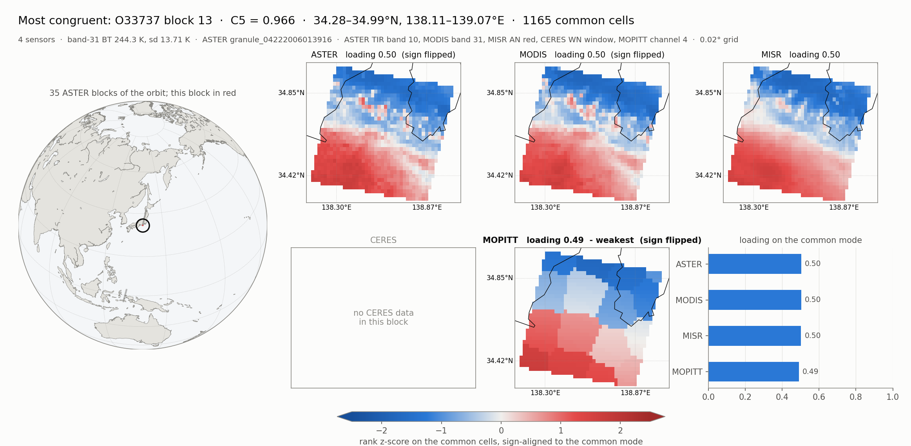
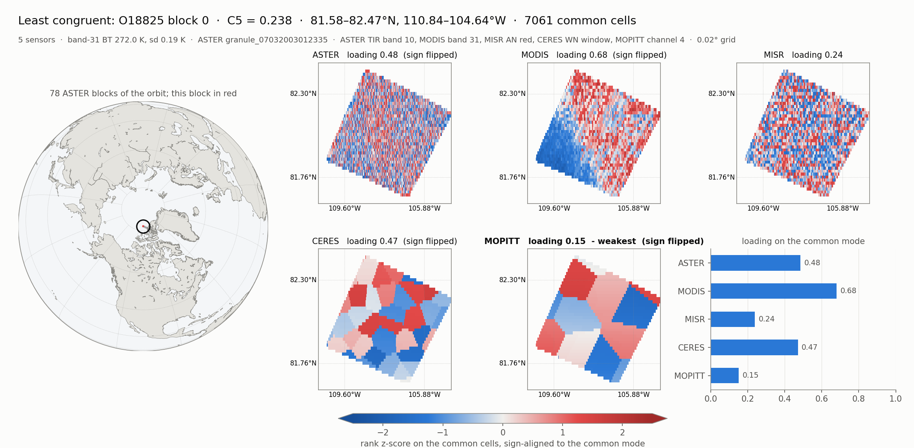

# Terra Fusion congruence over all of P108 on Aurora

Runs on **Aurora**, 2026-10-15 to 2026-10-16. This extends the one-node,
10-granule test in
[20261009_claude_terra_fusion_congruence_aurora.md](20261009_claude_terra_fusion_congruence_aurora.md)
(job 8917505) to every granule of WRS path 108 in `s3://terrafusiondatasampler`.
The pipeline is the same one: S3 → CAE → CTE tiers → clio-fs FUSE → the
unchanged netCDF4 scripts, with the regrid on a PVC tile (PVC = Ponte Vecchio,
the Intel Data Center GPU Max 1550; 6 per node, 2 tiles each).

## Headline

* **All 361 P108 granules were processed.** The final 8-node run (job
  8934328) imported and verified the remaining 313 granules (10.0 TB) in
  5 h 01 min, with no import failures.
* **291 granules have results: 13,111 blocks.** C5 ranges from 0.238 to 0.966
  (median 0.670) and agrees with Kendall's W at r = 0.989. The 70 granules
  without results are all **data conditions**, such as a missing sensor group
  or missing ASTER TIR. None is a software failure.
* **Lowest C5 above the 2 K contrast floor: O26281 block 45** (27.47–26.80°S,
  C5 0.332, BT₃₁ sd 4.33 K). Half of the 50 lowest blocks above the floor lie
  in one box in Western Australia (15–32°S, 118–127°E).
* **The S3 import was the bottleneck, and it needed a clio-core fix.**
  The first 8-node attempt (job 8932102) failed 156 of 199 imports with
  `ended short after 16 resumes` and was killed. With the backoff/retry fix
  ([iowarp/clio-core#1296](https://github.com/iowarp/clio-core/pull/1296)), no
  import failed.
* **The GPU regrid matched pytaf exactly** on O5544: 688,889 cells, 0 differed.

## The runs

| job | what | nodes | wall | outcome |
| --- | --- | --- | --- | --- |
| 8917505 | first 10 P108 granules (earlier doc) | 1 | 48 min | 7 with results |
| 8932032 | HBM overflow test, 3 granules | 1 | 14 min | passed (below) |
| 8932102 | all remaining P108, first try | 8 | 3 h 36 min, killed | 43 imported, 156 import failures, 38 with results |
| 8932341, 8932619, 8934120, 8934239 | rechunk-on-ingest prototype on O10903 | 1 | 28–56 min | result in 8934239 (below) |
| 8932554, 8932845 | the same prototype | 1 | 4–14 min | every import failed (S3) |
| 8934098, 8935997 | clio-core builds with the S3 fix | 1 | 2.5 min | built |
| **8934328** | **remaining 313 P108 granules** | **8** | **5 h 01 min** | **313 imported, 246 with results** |

Results: `/lus/flare/projects/IOWarp/hyoklee/tf_p108/run_8934328/` (`work/`
holds one directory per orbit, including links to the earlier runs; `rank.log`
holds the ranking).

## How it was set up

* **The OMNI file.** [`src/tf/tf_make_omni.py`](../src/tf/tf_make_omni.py) lists the
  bucket with unsigned requests and drops stub objects (under 100 MB). It
  writes [`omni/terra_fusion_p108.omni.yaml`](../omni/terra_fusion_p108.omni.yaml):
  361 transfers, 11.75 TB, largest first (O5544, 59.4 GB). O47950 is a
  2,176-byte stub and is excluded.
* **The split.** [`pbs/tf_p108.pbs`](../pbs/tf_p108.pbs) takes the granules not
  yet analysed and deals them out greedily, largest first, to the node with the
  fewest bytes. 313 granules came to 1,249–1,261 GB per node, 39–40 granules
  each. Orbits that already have a result in `PRIOR_WORK` are skipped, so a
  killed run resumes rather than restarts.
* **Memory.** Neither a node nor the project's 1 TiB Lustre quota (finding 7)
  holds 11.75 TB, so each node runs
  [`pbs/tf_congruence.pbs`](../pbs/tf_congruence.pbs) with `DELETE_AFTER=1`:
  a granule is unlinked from clio-fs as soon as its analysis ends. Ingest
  pauses while `MAX_RUNNING=6` analyses are running, so at most 7 granules are
  resident on a node. Tiers per node: DRAM 400 GB, GPU HBM 56 GB, Lustre 32 GB.
* **S3.** 8 streams × 32 MiB parts per node (the single-node runs used 16).

## Results

### Import (job 8934328)

| node | granules | GB | MB/s | analyses OK | data-condition failures |
| --- | --- | --- | --- | --- | --- |
| 0 | 39 | 1,249 | 89 | 30 | 9 |
| 1 | 39 | 1,249 | 76 | 35 | 4 |
| 2 | 39 | 1,250 | 78 | 31 | 8 |
| 3 | 39 | 1,249 | 85 | 30 | 9 |
| 4 | 40 | 1,261 | 89 | 30 | 10 |
| 5 | 39 | 1,250 | 70 | 29 | 10 |
| 6 | 39 | 1,249 | 71 | 31 | 8 |
| 7 | 39 | 1,250 | 71 | 30 | 9 |
| **total** | **313** | **10,009** | **555 overall** (10.0 TB in 5.0 h) | **246** | **67** |

Every granule was checked against S3 before analysis: its size, plus five
sampled 1 MiB ranges compared byte for byte. **313/313 matched.** Single-node
runs reached 105–115 MB/s; with 8 nodes on the same ALCF proxy, each node got
70–89 MB/s.

The new resume logic fired once: a part of O40028 got `HTTP 500` from the
proxy 29.9 GB into a 45 GB object. The part was fetched again and the import
completed. The old code would have failed that object and restarted it from
byte 0.

### How much data CAE moved

Over all the P108 work, CAE pulled **about 17 TB** from S3 to get 11.75 TB of
distinct granules. About 12.3 TB was in imports that finished. The other
4.4–5.5 TB was partial downloads from failed attempts, which were thrown away.

| what | imports | data |
| --- | --- | --- |
| **distinct P108 granules, each imported successfully at least once** | 361 | **11.75 TB** |
| final 8-node run (8934328) | 313 | 10.01 TB |
| killed 8-node run (8932102), finished imports | 43 | 1.62 TB |
| first one-node run (8917505) | 10 | 0.30 TB |
| repeat imports in tests (O10903 ×5, the HBM test, three O11835 smoke runs) | 12 | 0.38 TB |
| import benchmark (O12068 4.17 GB, 8 runs) | 8 | 0.03 TB |
| **all successful imports** | **384** | **≈ 12.3 TB** |
| failed attempts, partial bytes discarded | 525 | **4.4–5.5 TB** |
| **total CAE traffic** | | **≈ 16.7–17.9 TB** |

520 of the 525 failed attempts (4.2–5.4 TB) were in job 8932102, before the
clio-core fix. Each failure discarded everything fetched so far, typically
20–50 GB into a 25–60 GB granule, and the next try restarted from byte 0. The
other 5 were O10903 test runs (about 0.15 TB). After the fix, job 8934328 had
no failed attempts and moved exactly the 10.0 TB it needed.

Finished imports are exact, from the job logs' `ingested` lines. For a failed
attempt, the lower bound is the offset in its error message. The upper bound
adds one in-flight window (2 GiB at 16 streams × 32 MiB), since parts already
fetched in that window were lost too. The block maps' range reads (about
208 MiB) used plain HTTP, not CAE, and are not counted.

### Why 70 granules have no result

All are properties of the granule, and the scripts report them by name:

| cause | granules |
| --- | --- |
| no ASTER group | 24 (+2 in job 8917505: O1117, O12068) |
| no MOPITT group | 20 |
| one ASTER granule in the orbit has no TIR subsystem | 12 |
| no MISR group | 7 |
| no MODIS group | 2 |
| no MISR points inside the ASTER strip | 2 (+1 in job 8917505: O10437) |

The 12 TIR cases are recoverable: `tf_congruence.py` aborts the whole orbit
when one of its ASTER granules has no TIR, where it could skip just that
granule. This was not changed.

### The ranking (all of P108)

| | |
| --- | --- |
| granules / blocks | 291 / 13,111 (11,744 with all 5 sensors, 1,356 with 4, 11 with 3) |
| C5 | min 0.238, quartiles 0.584 / 0.670 / 0.750, max 0.966 |
| C5 vs Kendall's W | r = 0.989 |
| above the 2.0 K BT₃₁ floor | 10,116 blocks, median C5 0.694; below it, median 0.560 |
| weakest sensor | MISR 6,776 (52%), MOPITT 4,806 (37%), CERES 1,247, ASTER 228, MODIS 54 |
| lowest above the floor | **O26281 blk 45**, 27.47–26.80°S, C5 0.332, BT₃₁ sd 4.33 K, MOPITT weakest |
| lowest overall | O18825 blk 0, 81.6–82.5°N, C5 0.238 (below the floor: sd 0.19 K) |
| highest | O33737 blk 13, 34.3–35.0°N, C5 0.966 |

**Western Australia keeps recurring.** 1,071 blocks fall in 15–32°S,
118–127°E, with median C5 0.505 against 0.670 overall. 25 of the 50 lowest
blocks above the floor are there, in different orbits and years: O26281,
O11602, O74046, O55173, O14631, O68221, O54474 and others. The weakest sensor
varies (MISR, MOPITT, CERES). That points at the scene, hot arid land with
strong small-scale contrast, rather than at one instrument. This is an
inference from the ranking and has not been checked against the imagery.

The earlier 7-granule answer (O11602 blk 46, C5 0.355) is now 2nd above the
floor.

### The most and least congruent blocks

Drawn by [`src/tf/tf_block_map.py`](../src/tf/tf_block_map.py). The script
rebuilds the block's five fields exactly as `tf_congruence.py` does. It reads
ASTER TIR from S3 with range GETs (about 104 MiB per block; the granules were
deleted after analysis) and the other sensors from the run's npz. The
recomputed C5 matches the ranking to 4 decimals for both blocks. Each panel
shows one sensor's rank z-score on the common cells, sign-aligned to the
common mode, on one shared scale.

**Most congruent: O33737 block 13, C5 = 0.966**, off Shizuoka, Japan. The
four sensors share a cold-north / warm-south split (BT₃₁ 244 K, sd 13.7 K,
likely a cloud edge). There are no CERES points, so C5 here is over 4 sensors.



**Least congruent: O18825 block 0, C5 = 0.238**, in the Canadian Arctic. With
BT₃₁ sd 0.19 K the scene is nearly uniform: ASTER and MISR show mostly noise,
and only MODIS has a gradient. The low score reflects missing contrast, not
sensors disagreeing about a real signal. The 2 K floor exists to remove blocks
like this one.



## Findings along the way

### 1. S3 imports through the ALCF proxy fail in bursts (fixed in clio-core)

The symptom was `S3 GET <key> ended short after 16 resumes`, on 25–60 GB
objects, about 20–50 GB in. In `s3_file_assimilator.cc`:

* `FillChunk` resumed a dropped stream immediately. When the proxy dropped
  connections for a few seconds, all 16 resumes (`kMaxResumes`, a compile-time
  constant) were spent in milliseconds.
* One failed 32 MiB part failed the whole object, and the only recovery was a
  full re-download. The job script's 3 tries then wasted up to 800 s each.
* The failures got worse with load. One node's import sometimes failed; with
  8 nodes × 16 streams, 156 of 199 failed (job 8932102).

The fix, on branch `fix/s3-resume-backoff`, is
[iowarp/clio-core#1296](https://github.com/iowarp/clio-core/pull/1296):

* A backoff before each resume: `CAE_S3_BACKOFF_MS`, 500 ms doubling to 30 s.
* Only resumes in a row that deliver nothing count against
  `CAE_S3_MAX_RESUMES` (16).
* A failed resume GET is retried.
* A failed part is fetched again from its first unfilled chunk, on a fresh
  connection, up to `CAE_S3_PART_RETRIES` (4) times.

Combined with 8 streams per node, no import failed across 313 granules.

### 2. HBM works as an overflow tier, but only one tile of it

Job 8932032 ran with DRAM capped at 36 GB and HBM at 56 GB, on three granules
(85 GB). 46.2 GB spilled into HBM at 115 MB/s, the results were identical to
ares, and unlinking a granule freed every tier. However, the HBM tier is one
`sycl::malloc_device` on the default device, which in FLAT mode is one PVC
tile, so it holds at most about 60 GB per node out of the 6 × 128 GB
available. Using all of it would need a `device:` field on the storage device
config, threaded through bdev creation, per-device GpuApi allocations and
queues, and the memory transport. That was not implemented. For this workload
it is not needed: one Aurora node has about 1.1 TB of DRAM, and with
`DELETE_AFTER` the resident set stays far below that.

### 3. GPU memory does not speed up decompression

Placement alone changed nothing (O11835 sourced in 9 s from HBM, as from DRAM).
The time goes into inflating deflate streams, which decode sequentially on the
CPU: MISR Red_Radiance is a single 755 MB chunk. Rechunking or caching
decompressed data would help, but Aurora is limited by S3 ingest anyway.

### 4. Rechunk-on-ingest: works, but small gain

[`src/tf/tf_rechunk.py`](../src/tf/tf_rechunk.py) copies a granule with
H5Ocopy and recreates the chosen datasets with smaller chunks. It keeps the
source's own filters and fill value. On O10903, with Red_Radiance changed from
one 180×512×2048 chunk to 180 chunks of 1×512×2048 (job 8934239, two passes
each):

| variant | MISR read | pipeline per pass | output vs full read |
| --- | --- | --- | --- |
| full read (default) | 4.31 / 4.33 s | 43 / 39 s | — |
| 46 SOM blocks the strip touches (`TF_MISR_SUBSET=1`) | 3.32 / 3.31 s | 38 / 39 s | byte-identical |
| same, rechunked | **1.87 / 1.87 s** | **37 / 36 s** | byte-identical |

That saves about 2.5 s per pass (6%), and rechunking that one dataset costs
9 s. It pays back only for a granule analysed 4 or more times, so it is not used
in the P108 runs. Rechunking every oversized dataset (631 of them, 37 GB) took
1,647 s, mostly ASTER arrays that the pipeline reads whole.

Two traps were found along the way:

* **Per-group H5Ocopy leaves every dimension scale dangling.** In these
  granules every `DIMENSION_LIST` points into another top-level group
  (O12068: 422 of 422). netCDF4 then refuses the copy (`NetCDF: HDF error`).
  The tool deletes the copied `REFERENCE_LIST`/`DIMENSION_LIST` attributes and
  re-attaches the scales by name.
* **`module load frameworks` overwrites `INCLUDE`.** The tool's dataset list
  was first passed as `INCLUDE`, which the module system prepends compiler
  include paths to, so two jobs rechunked nothing. It is now
  `RECHUNK_INCLUDE`.

clio-fs itself stores files correctly: an HDF5 file written through FUSE, one
written to `/tmp`, and one `cp`'d into clio-fs had the same md5.

### 5. A job can hang after "done"

Job 8934120 printed `done` at +926 s and then held its node for another 40
minutes in cleanup (8934239: 13 minutes). The logs do not show which step
hung: the FUSE unmount or `clio_run stop`. Every cleanup step in
`tf_congruence.pbs` is now bounded by a timeout and logged, which caps
teardown at about 5 minutes. The cause is still unknown.

### 6. Scheduling

The `capacity` queue allows 1–16 nodes, up to 168 h, 2 running and 5 queued
jobs per user. Both 8-node jobs started after 3–4 hours in the queue. `debug` allows one
queued job per user, so a build and its test cannot both be queued.

### 7. The IOWarp Lustre quota cannot hold P108

The IOWarp project's quota on `/lus/flare` is **1 TiB** (`myprojectquotas`,
2026-10-16). 271.6 GiB of it is used, leaving about 750 GiB. The group has no
separate quota of its own (`lfs quota -g IOWarp`: default settings).

| | size | vs the 1 TiB quota |
| --- | --- | --- |
| all of P108 (361 granules) | 11.75 TB = 10.7 TiB | **10.7×** the whole quota |
| the 313 granules of job 8934328 | 10.0 TB = 9.1 TiB | 9.1× |
| free space now | about 750 GiB | ≈ 24 average granules (32.6 GB), or 13 of the largest (59.4 GB) |
| whole bucket (5,058 objects) | 149.8 TB = 136 TiB | 136× |

**Staging P108 on Lustre is not an option**, and neither is staging one node's
share: about 1.25 TB per node is more than the whole quota. That is why the
runs stream instead:

* granules land in the DRAM tier;
* each one is deleted once its analysis ends (`DELETE_AFTER=1`);
* the Lustre tier is a small last-resort overflow. It was a 32 GB sparse file
  per node (256 GB across 8 nodes), deleted at job exit, and it held no data.

Even the 8 nodes' combined DRAM tiers (8 × 400 GB = 3.2 TB) hold only about
a quarter of P108, so streaming would be needed even without the quota.

What stays on Lustre is the results: about 0.5 GB per granule, almost all of
it the `regrid_inputs` npz. The P108 run directories take 78 GB (8934328) and
13 GB (8932102), so all 361 granules' results fit comfortably.

## Caveats

* The proxy was mostly calm during job 8934328, so the clio-core fix was
  exercised only once. The killed run's failure rate shows what it is up
  against.
* One run per configuration; the rechunk timings are two passes on one granule.
* `tf_compare_ares.py` was not run on the new granules: ares has results only
  for the first 10. The pipeline is the same code that reproduced those exactly.
* The Western Australia pattern is a reading of the ranking, not an
  investigation.

## Reproducing

```sh
python3 src/tf/tf_make_omni.py P108 > omni/terra_fusion_p108.omni.yaml
qsub bin/build_tf_aurora.pbs        # clio-core with the S3 fix (~3 min, debug)
qsub pbs/tf_p108.pbs                # 8 nodes, ~5 h; resumes from PRIOR_WORK
qsub -q debug -l walltime=01:00:00 \
     -v "GRANULES=O10903,RECHUNK=1,SKIP_REPORT=1,HBM_GB=0,RECHUNK_INCLUDE=MISR/AN/Data_Fields/Red_Radiance" \
     pbs/tf_congruence.pbs          # rechunk prototype
python src/tf/tf_block_map.py <work>/O33737 13 \
     P108/TERRA_BF_L1B_O33737_20060422005935_F000_V001.h5 out.png   # block map
```

Python: `frameworks/2026.1.0` plus the venv
`/lus/flare/projects/IOWarp/hyoklee/venv-tf` (netCDF4, and now basemap 2.0.0),
and pytaf in `/lus/flare/projects/IOWarp/hyoklee/pytaf` (`PYTAF_DIR`).
