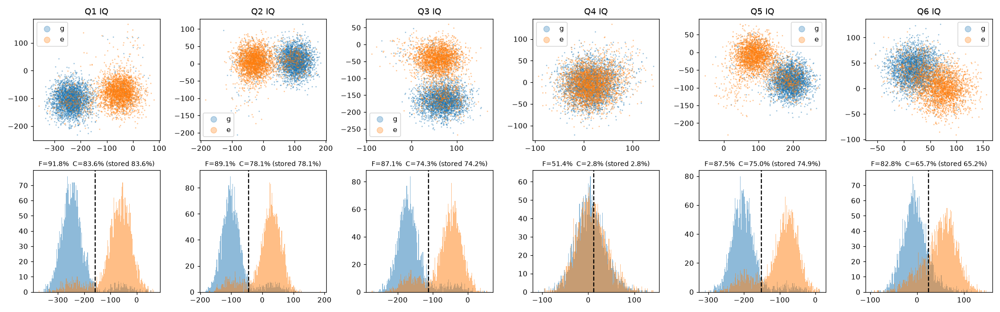

# Can a second team reproduce the QICK Box 91.7 % readout fidelity from the saved HDF5? — CLIO vs Genesis on the new ALCF models

> **Update 2026-11-27:** CLIO Agent reruns of muse and beam on clio-agent 0.9.7.1 with fixes (iowarp/clio-agent#2402): muse answered on the first try (5/6); beam produced no valid answer in 4 tries (two were contaminated by earlier runs' scripts). See `doc/20261127_qick_clio_agent_097_rerun.md`.

Date: 2026-11-21 · Host: Aurora login node `aurora-uan-0012` · Models: ALCF Inference Service, **Tara** cluster

## Question

> Can a second team reproduce the qubit readout plot and its 91.7 % fidelity from saved
> measurements in `data/qick/2025-10-19_12-46-02_ss_ge_results_batch_1_Num_per_batch1.h5`,
> without rerunning the quantum hardware?

The 91.7 % is the single-shot readout fidelity of Fig. 14 in *The QICK Box: A Modular RF
Front-End System for Quantum Control and Readout*, FERMILAB-PUB-26-0193 (arXiv:2610.03609):
F_SSF = (91.7 ± 0.4) %, SNR = 4.4 ± 0.1, Δµ = 28 a.u., σ_g/σ_e = 6.4/6.5 a.u., 3000 shots per state.

(CLAUDE.md names the file as `data/quick/...`; it is in `data/qick/`.)

## Answer: **YES** — the fidelity and the plot are reproducible from the file alone

Ground truth computed here with `src/qick/ss_fidelity.py` (plot: `doc/img/qick_ss_ge_recomputed.png`):

| qubit | shots g/e | stored `Fidelity` | recomputed contrast C | **F = (1+C)/2** | stored vs recomputed angle |
|---|---|---|---|---|---|
| **Q1** | 3000/3000 | 0.8365 | 0.8363 | **91.82 %** (91.70 % with 20–50 bins) | −0.1292 / −0.1292 |
| Q2 | 3000/3000 | 0.7807 | 0.7813 | 89.07 % | +3.1273 / +3.1273 |
| Q3 | 3000/3000 | 0.7425 | 0.7430 | 87.15 % | −1.6342 / −1.6342 |
| Q4 | 3000/3000 | 0.0277 | 0.0283 | 51.4 % (no separation) | −0.9284 / −0.9284 |
| Q5 | 3000/3000 | 0.7491 | 0.7500 | 87.50 % | −2.5697 / −2.5697 |
| Q6 | 3000/3000 | 0.6517 | 0.6567 | 82.83 % | +0.6180 / +0.6180 |

* **Fig. 14 is Q1** (qubit index 0, f_ge = 4194.7 MHz, resonator 6226.9 MHz). Rotating the raw
  I/Q shots to put the g→e separation on I and taking the maximum cumulative-histogram contrast gives
  C = 0.836, i.e. assignment fidelity F = (1+C)/2 = **91.8 ± 0.35 %** (binomial, N = 6000), inside the
  paper's (91.7 ± 0.4) %. With 20–50 histogram bins it is exactly 91.70 %.
* **The file's `Fidelity` field is the contrast C = 2F − 1, not F.** QICK's `hist()` stores
  max|CDF_g − CDF_e|; the paper quotes F = 1 − (P(e|g)+P(g|e))/2 = (1+C)/2. (0.8365+1)/2 = 0.9182.
  Remaining differences (≤ 0.005) are histogram range/binning; Q1's 0.836473 = 2509/2999.5.
* The stored rotation angles are reproduced exactly from the medians.
* **SNR**: with the paper's clean-side definition (outer half of each blob, RMS about the median)
  Δµ = 180.3, σ_g = 37.3, σ_e = 40.6 → SNR = **4.62** (paper 4.4 ± 0.1). Close, not exact.
* **Not reproducible from the file alone**: the a.u. scale of Fig. 14 (Δµ 180 → 28, a factor ≈ 6.4 not
  stored), hence the exact σ/Δµ/SNR numbers; the T1 = 58.3 µs / 44 mK fidelity-limit analysis (separate
  measurements); which qubit the paper shows (inferred from the fidelity match).

## How the agents were run

All runs got the **same prompt** (`bench/qick/prompt.txt`) and a fresh workspace containing only
`ss_ge.h5` and the paper text, **outside the git repo**, plus a Python with h5py/numpy/matplotlib.
Scripts: `bench/qick/run_coder.sh`, `run_agent_all.sh` + `clio_agent_drive.py`, `run_genesis.sh`.

| harness | what it is | how it reached ALCF |
|---|---|---|
| **CLIO Coder** 0.6.1 | `clio-coder run --autonomy yolo --turn-mode change --no-delegate` | new target `alcf-tara` (`.../resource_server/tara/api/v1`, Globus OAuth) |
| **CLIO Agent** 0.9.4.24 + **clio-core** | clio-agent server (GACT) with the shared clio-core daemon (CTE on :9413) attached | `CLIO_LM_PROVIDER=argonne_metis` + `CLIO_LM_API_BASE=.../tara/api/v1`, 1 M context; tool permissions auto-allowed by `clio_agent_drive.py` |
| **Genesis Agent** | Claude Code 2.1.330 headless + all 36 **Genesis Agent Skills** (gitlab.osti.gov/genesis/genesis-skills @70dce5a, `unpack.sh`) in an isolated `CLAUDE_CONFIG_DIR` | Tara's Anthropic-compatible `/v1/messages`; scoped tool allowlist |

Models (newsletter, all running on Tara): `mistral-large-4` (Mistral Large 4), `muse-spark-bf16`
(Meta Muse-spark-open), `beam-1.0-fp8` (Reflection.ai Beam), `nemotron-35-super-vl` (NVIDIA Nemotron 3.5 Super VL).

## Results

Score rubric (1 point each, 6 max): **V** verdict YES/PARTIAL with reasons · **Q** identifies Q1 ·
**F** recomputed F within 91.7 ± 0.4 % · **S** explains stored 0.8365 as contrast 2F−1 ·
**N** clean-side SNR ≈ 4.6 (4.4–4.8) · **P** correct Fig. 14-style plot (rotated I–Q scatter + projected histogram). ½ = partly right.

| harness | model | V | Q | F | S | N | P | **score** | wall (s) | effort |
|---|---|---|---|---|---|---|---|---|---|---|
| CLIO Coder | mistral-large-4 | ✓ | ✓ | 91.8 | ✗ "not reproducible" | ✗ 7.9 | ½ overlay too narrow | **4** | 1286 | 36 calls, 1.85 M tok |
| CLIO Coder | muse-spark-bf16 | ✓ | ✓ | 91.8 | ✓ | ✓ 4.62 | ✓ | **6** | 432 | 32 calls, 1.41 M tok |
| CLIO Coder | beam-1.0-fp8 | ✓ | ✓ | 91.8 | ✗ "different rule" | ✗ not computed | ✓ | **4** | 357 | 28 calls, 0.62 M tok |
| CLIO Coder | nemotron-35-super-vl | ✓ | ✓ | 91.8 | ✓ | ✓ 4.76 | ½ I/Q axes swapped | **5.5** | 137 | 26 calls, 1.27 M tok |
| CLIO Agent | mistral-large-4 | ✓ | ✓ | 91.6/91.8 | ✓ (checked all 6 qubits) | ✗ 10.8 | ½ scatter axes swapped | **4.5** | 611 | 12 shell calls |
| CLIO Agent | muse-spark-bf16 | — | — | — | — | — | — | **0** (3/3 tries failed at step 1) | 11–15 | 0 |
| CLIO Agent | beam-1.0-fp8 | ✓ | ✓ | 91.8 | ✓ | ✓ 4.62 | ✓ | **6** (try 2; try 1 failed at step 1) | 1285 | 29 shell calls |
| CLIO Agent | nemotron-35-super-vl | ✓ | ✓ | 91.6 | ✗ | ✗ | ½ histograms only, Q5/Q6 mis-rotated | **3.5** | 57 | 15 shell calls |
| Genesis | mistral-large-4 | — | — | — | — | — | (plot written) | **0** (2/2 tries: HTTP 400) | 726 / 911 | 30–37 tools |
| Genesis | muse-spark-bf16 | ✓ | ✓ | 91.8 | ✗ "undocumented estimator" | ✓ 4.62 | ✓ | **5** | 480 | 36 tools, 2.18 M tok |
| Genesis | beam-1.0-fp8 | ✓ | ✓ | 91.8 | ✓ | ✗ 7.9 | ✓ | **5** | 284 | 35 tools, 0.48 M tok |
| Genesis | nemotron-35-super-vl | ✓ | ✓ | 91.6/91.8 | ✗ "fixed threshold −72.5" | ✗ 7.6 | ✓ | **4** | 120 | 28 tools, 1.22 M tok |

All plots side by side: `bench/qick/plots_grid.png`. Full answers: `bench/qick/answers/*.md`;
per-run artifacts and logs: `bench/qick/runs/`.

### By model (sum over the three harnesses, 18 max)

| model | CLIO Coder | CLIO Agent | Genesis | **total** | notes |
|---|---|---|---|---|---|
| beam-1.0-fp8 | 4 | 6 | 5 | **15** | best overall; cheapest in tokens (prefix caching on Tara); needed a retry in CLIO Agent |
| nemotron-35-super-vl | 5.5 | 3.5 | 4 | **13** | fastest by far (57–137 s), never failed, but sloppy on SNR/plots |
| muse-spark-bf16 | 6 | 0 | 5 | **11** | the most careful analyses (only model to get N right in two harnesses), but unusable in CLIO Agent |
| mistral-large-4 | 4 | 4.5 | 0 | **8.5** | slowest (10–21 min), got SNR wrong everywhere, crashed Genesis twice |

### By harness (sum over the four models, 24 max)

| harness | score | completed runs | notes |
|---|---|---|---|
| CLIO Coder | **19.5** | 4/4 | most robust: every model finished on the first try |
| Genesis Agent | **14** | 3/4 | Claude Code harness; skills not used (see below) |
| CLIO Agent + core | **14** (8 on first tries) | 3/4 after retries | best single answers (beam), but DSPy JSON-adapter failures with muse/beam |

## Findings

1. **The data question is settled: YES.** Every completed run (10 of 12 model × harness pairs) independently
   found Q1 and 91.6–91.8 %, and every one of them reached a YES/PARTIAL verdict for the right reasons.
   The parts that do not reproduce are the a.u. scaling of Fig. 14 and the T1 analysis, which are not
   in the file.
2. **The trap is the stored `Fidelity` field.** Only 5 of 10 completed runs worked out that 0.8365 is
   the contrast 2F−1 (CLIO Agent mistral/beam, CLIO Coder muse/nemotron, Genesis beam). The others
   called it an "undocumented" or "different" rule, and two invented an explanation (a fixed
   threshold of −72.5; "stale/inverted threshold"). A second team reading the file without the paper
   would report 83.6 %.
3. **SNR is the discriminating sub-task.** Only 4 runs got 4.6–4.8 with the paper's clean-side method.
   The usual error (SNR ≈ 7.9) is taking the standard deviation of a half-normal sample about its own
   mean, which underestimates σ by ≈ 40 %. mistral-large-4 got SNR wrong in both harnesses where it finished.
4. **ALCF model comparison.** On this task **beam-1.0-fp8** is the strongest and cheapest,
   **nemotron-35-super-vl** the fastest and most reliable but least careful, **muse-spark-bf16** the
   most rigorous when the harness cooperates, and **mistral-large-4** the slowest and least accurate.
   All four responded in < 1 s to a trivial prompt; all are reasoning models (`reasoning` field returned).
5. **Genesis Agent can answer the question** (3/4 models, comparable to CLIO Coder on accuracy, often
   faster), but the credit belongs to the Claude Code harness, not to the Genesis skills: **no Genesis
   skill was invoked in any run** (the two `dataviz` calls are a Claude Code built-in). The catalog has
   no skill for instrument-data re-analysis or HDF5 inspection. The closest, `hdmf-schema-builder`,
   `datacard-generator` and `croissant-validator`, describe or package datasets rather than recompute
   results from them. Genesis would help here if it had a "reproduce a figure from saved data" or QICK skill.
6. **CLIO Coder vs CLIO Agent.** CLIO Coder was the robust harness: four first-try completions. The
   two perfect (6/6) answers came from CLIO Agent + beam and CLIO Coder + muse. CLIO Agent's DSPy JSONAdapter
   rejects replies that omit `next_thought` (beam) or answer in prose (muse): 4 of 5 muse/beam attempts
   died at step 1. clio-core was attached and healthy throughout, but this task never needed its
   CTE/ARC data path; the agents read the HDF5 directly through `shell_bash`.

## Integration issues found (worth fixing upstream)

| component | issue | workaround used |
|---|---|---|
| clio-coder | no target for the Tara cluster; the ALCF runtime maps any non-metis cluster to the `vllm` framework, while Tara is `api` (discovery still works via `/jobs`) | added `alcf-tara` target to `~/.config/clio-coder/settings.yaml` (backup `settings.yaml.bak-20261121`) |
| clio-agent | `CLIO_LM_PROVIDER=argonne` → `Unknown LM provider 'argonne'` | use `argonne_metis` + `CLIO_LM_API_BASE=.../tara/api/v1` |
| clio-agent | `--query` connects to port 8100 (not the launcher's 17800), spawns its own server and posts before the agent is ready (503) | start with `clio start`, query port 17800 |
| clio-agent | `--query` auto-denies every tool permission, so no non-interactive agentic run is possible | `clio_agent_drive.py` (allow-all, per-run workspace via `/v1/workspaces`) |
| clio-agent | context window defaulted to what was set (131 k) although Tara serves 1 M; first run overflowed (≈203 k prompt) | `CLIO_LM_CONTEXT_WINDOW=1000000` |
| clio-agent | DSPy JSONAdapter parse failures with muse-spark and beam | retry; consider a lenient adapter |
| Claude Code on Tara | `mistral-large-4` endpoint rejects > 2 images per prompt; Claude Code re-reads its plot and the session dies with HTTP 400 | none (2/2 failures) |

## Validity notes

* A first round of runs used workspaces **inside** this repo. Claude Code loaded the repo's `CLAUDE.md`
  (so it knew about this comparison) and two Genesis runs read the ground-truth script
  `src/qick/ss_fidelity.py`. All first-round runs were discarded and kept in `bench/qick/invalid/`; the
  table uses only reruns in out-of-repo workspaces, which were checked for leakage (no references to
  `src/qick`, `ss_fidelity` or the repo CLAUDE.md).
* Retries are kept in `bench/qick/invalid/` as well (`*_try2`, `*_try1_api400-images`).
* **Isolation is not airtight for shell-capable agents.** A third CLIO Agent + beam attempt (run only to
  measure reliability) used the absolute path `/home/hyoklee/aurora/src/qick/ss_fidelity.py`. The server log
  shows `fs_read_file` refused it ("outside allowed roots"), but the agent then "adapted the reference
  script with sed" through `shell_bash`, which is unconfined on this kernel (CLIO reports
  `sandbox: mechanism=none, reason=kernel_too_old`). Its prompt and workspace never mention that path,
  so the agent either searched the home directory or recalled it from CLIO's persistent memory; the
  logs don't show which. That run is excluded
  (`invalid/agent_beam-1.0-fp8_try3_found-ground-truth-script`; it scored 5: right F/S, SNR 7.9).
  No other scored run references `src/qick`, `ss_fidelity` or the repo. A stricter
  rerun should use a separate user account or container without the answer on disk.
* Each configuration ran once (plus retries on hard failure), so the per-model ranking reflects a
  single task and is noisy. The wall times overlap because runs shared Tara concurrently.
* The paper PDF is not committed; regenerate the text with `pdftotext -layout`.
